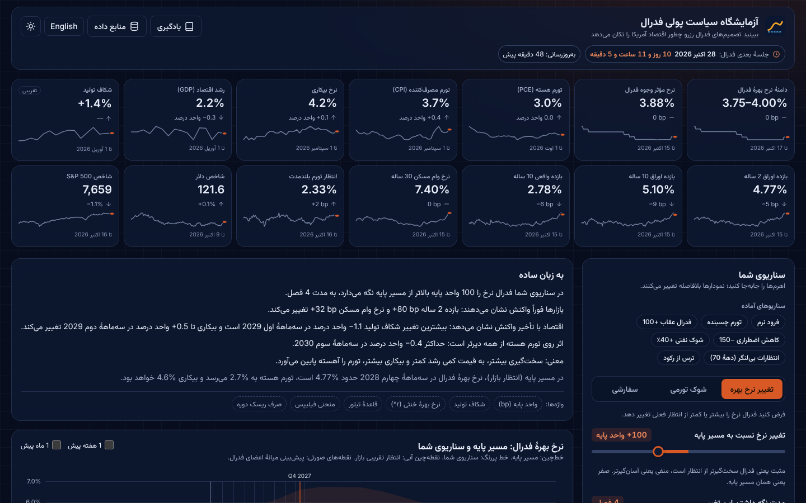
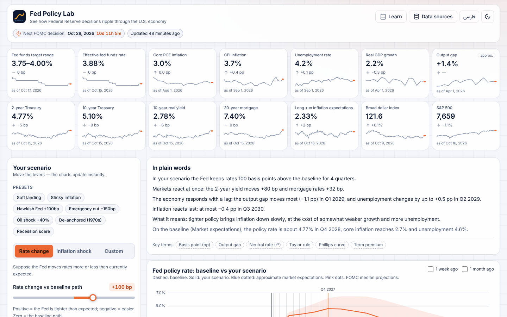
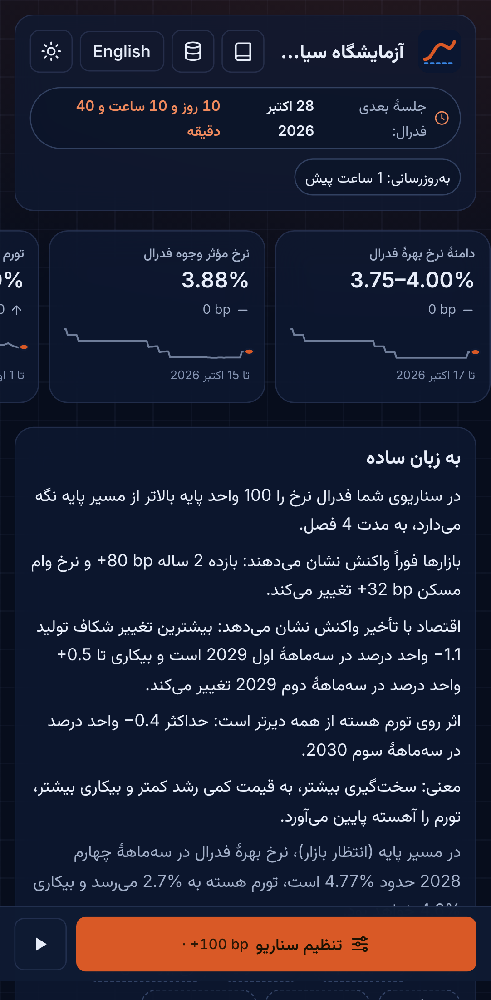
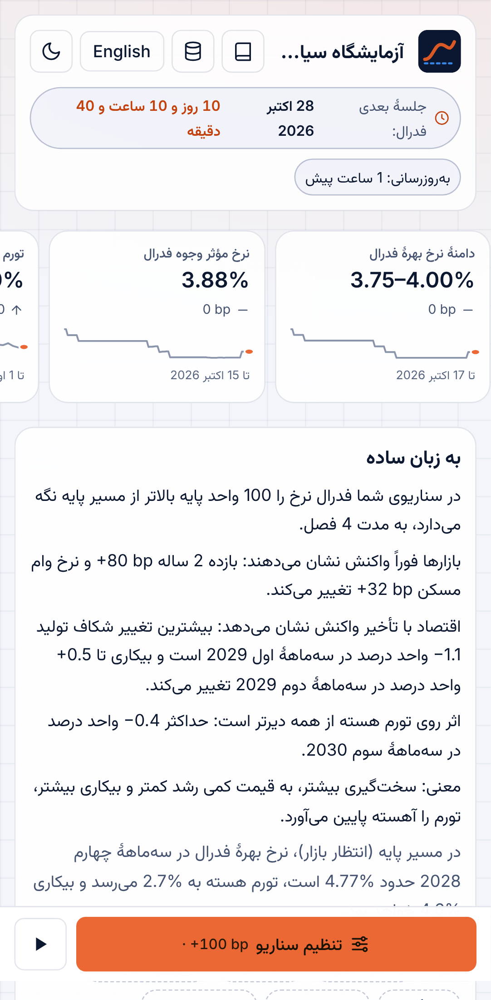
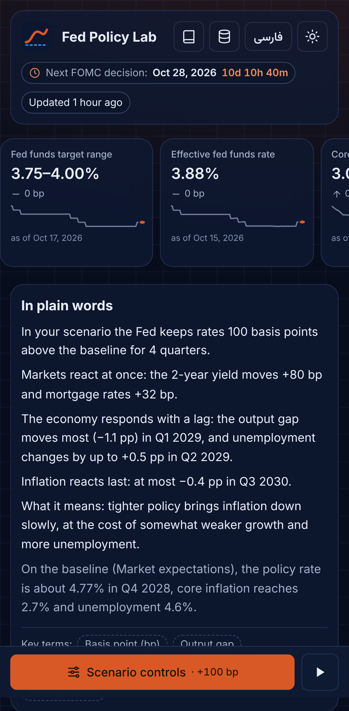
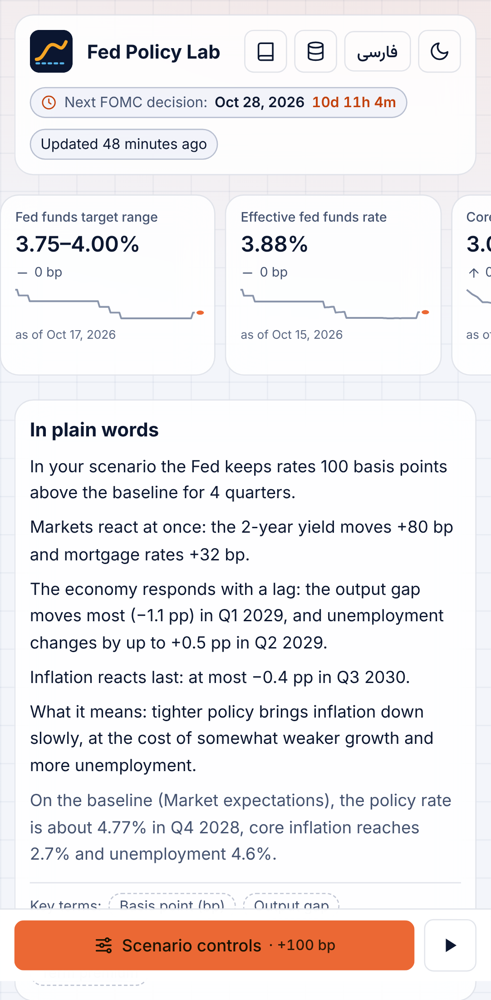

# Fed Policy Lab · آزمایشگاه سیاست پولی فدرال

[](https://github.com/SinaFXD/test/actions/workflows/deploy.yml)
[](https://github.com/SinaFXD/test/actions/workflows/update-data.yml)

**Live:** https://sinafxd.github.io/test/ (after GitHub Pages is enabled; see below)

<p align="center">
  
  
</p>
<p align="center">
  
  
  
  
</p>

[فارسی](#فارسی) · [English](#english)

---

<div dir="rtl">

## فارسی

**آزمایشگاه سیاست پولی فدرال** یک شبیه‌ساز آموزشی و تعاملی است: آخرین داده‌های رسمی اقتصاد آمریکا را
(به‌صورت خودکار و بدون هیچ کار دستی) نشان می‌دهد و به شما اجازه می‌دهد با چند اهرم ببینید تغییر نرخ بهره،
شوک تورمی یا شوک نفتی در ۲ تا ۵ سال آینده چه اثری بر تورم، بیکاری، رشد، بازده اوراق، وام مسکن، دلار و سهام
دارد. همه‌چیز به زبان ساده توضیح داده شده است.

> ⚠️ **صداقت:** این یک مدل **آموزشی و ساده‌شده** است که از مدل FRB/US فدرال رزرو **الهام گرفته**؛ خودِ FRB/US
> نیست، **پیش‌بینی نیست** و **توصیهٔ سرمایه‌گذاری نیست**. هر عدد منبع و تاریخ دارد و مقادیر تقریبی با
> «تقریبی» مشخص شده‌اند. داده‌ها فقط از API رسمی و رایگان FRED گرفته می‌شوند.

### امکانات

- داده‌های زنده: نرخ فدرال، تورم PCE و CPI، بیکاری، رشد، شکاف تولید، منحنی بازده، وام مسکن، انتظارات تورمی، دلار، S&P 500
- شمارش معکوس تا جلسهٔ بعدی FOMC و نشان «قدیمی» برای داده‌های دیرشده
- سه سناریو (تغییر نرخ، شوک تورمی، سفارشی)، تنظیمات پیشرفته و ۷ سناریوی آماده
- نمودار نرخ بهره با مسیر تقریبی بازار، پیش‌بینی‌های فدرال (SEP)، نوار عدم‌قطعیت و مقایسه با یک هفته/یک ماه پیش
- نمودارهای کوچک همگام، «سفر در زمان»، خط زمانی انتقال اثر، خلاصهٔ خودکار به زبان ساده
- پخش فصل‌به‌فصل، لینک اشتراک، خروجی CSV و تصویر، فارسی/انگلیسی، تم تیره/روشن، موبایل

### اجرای محلی

پیش‌نیاز: Node.js نسخهٔ ۲۲ (LTS).

```bash
npm ci
npm run dev          # http://localhost:5173 — بدون کلید API هم کار می‌کند (از دادهٔ موجود در مخزن)
```

دستورهای دیگر: `npm run build` · `npm test` · `npm run calibrate` · `npm run fetch-data` · `npm run e2e`

### گرفتن کلید رایگان FRED

1. در https://fred.stlouisfed.org/ یک حساب رایگان بسازید.
2. به https://fred.stlouisfed.org/docs/api/api_key.html بروید و «Request API Key» را بزنید.
3. برای اجرای محلی: فایل `.env.example` را به `.env` کپی کنید و `FRED_API_KEY=...` را بنویسید
   (فایل `.env` هرگز در گیت ثبت نمی‌شود). سپس `npm run fetch-data`.

### راه‌اندازی روی GitHub (یک بار)

1. **افزودن کلید به Secrets:** مخزن ← Settings ← Secrets and variables ← Actions ← New repository secret ←
   نام: `FRED_API_KEY`، مقدار: کلید شما.
2. **فعال کردن GitHub Pages:** Settings ← Pages ← Build and deployment ← Source: **GitHub Actions**.
3. **ادغام در شاخهٔ پیش‌فرض (`master`):** انتشار و زمان‌بندی خودکار فقط از شاخهٔ پیش‌فرض اجرا می‌شوند.
4. **اجرای دستی به‌روزرسانی داده:** تب Actions ← «Update data» ← Run workflow.

پس از آن داده‌ها هر روز کاری دو بار (۱۳:۴۵ و ۲۲:۱۵ به وقت UTC) خودکار به‌روز و سایت دوباره منتشر می‌شود.
اگر دریافت یا اعتبارسنجی داده شکست بخورد، چیزی ثبت یا منتشر نمی‌شود و سایت با دادهٔ معتبر قبلی کار می‌کند.

### اگر GitHub زمان‌بندی را متوقف کرد

گیت‌هاب در مخازن عمومی، workflowهای زمان‌بندی‌شده را پس از **۶۰ روز بدون فعالیت** غیرفعال می‌کند. برای فعال‌سازی
دوباره: تب Actions ← «Update data» ← دکمهٔ **Enable workflow**، سپس یک بار **Run workflow** بزنید.

</div>

---

## English

**Fed Policy Lab** is an interactive, auto-updating, educational simulator. It shows the latest official
U.S. macro and Fed data (refreshed automatically) and lets you move sliders — policy-rate changes,
inflation shocks, Fed hawkishness, oil shocks — to see how inflation, unemployment, GDP, yields,
mortgage rates, the dollar and stocks respond over the next 2–5 years, explained in plain language.

> ⚠️ **Honesty:** this is a **simplified educational model inspired by** the Fed's FRB/US model. It is
> **not FRB/US, not a forecast and not investment advice.** Every number shows its source and "as of"
> date; approximations are labeled. Data come only from the official, free FRED API.

### Features

- Live data: fed funds range, EFFR, core PCE, CPI, unemployment, GDP growth, output gap, 2y/10y/real
  yields, mortgage rates, 5y5y inflation expectations, dollar index, S&P 500 — with sparklines,
  as-of dates and staleness badges
- Countdown to the next FOMC decision
- Scenario tabs (rate change, inflation shock, custom), advanced settings and 7 presets
- Policy-rate chart with approximate market path, FOMC SEP dots, uncertainty fan, ELB, meeting markers
  and market paths from 1 week / 1 month ago
- Synced small multiples, time scrubber, transmission timeline, auto-generated summary, market rules of thumb
- Play animation, shareable URL, CSV & PNG export, Persian (RTL) / English, dark / light, mobile-first

### Run locally

Requires Node.js 22 LTS.

```bash
npm ci
npm run dev          # works without an API key, using the data committed in the repo
```

| Command                 | Purpose                                                                   |
| ----------------------- | ------------------------------------------------------------------------- |
| `npm run build`         | Type-check and build to `dist/`                                           |
| `npm test`              | Unit, model, calibration and component tests                              |
| `npm run calibrate`     | +100bp experiment vs FRB/US-like target ranges                            |
| `npm run fetch-data`    | Refresh data from FRED (needs `FRED_API_KEY`)                             |
| `npm run validate-data` | Validate data files and scan for a leaked key                             |
| `npm run e2e`           | Playwright smoke test + screenshots (desktop/mobile × FA/EN × dark/light) |

### Get a free FRED API key

1. Create a free account at https://fred.stlouisfed.org/.
2. Visit https://fred.stlouisfed.org/docs/api/api_key.html and request a key.
3. Locally: copy `.env.example` to `.env` and set `FRED_API_KEY=...` (never committed), then
   `npm run fetch-data`. The key is used only by the Node script and never reaches the browser bundle.

### Deploy on GitHub (one-time setup)

1. **Add the secret:** Settings → Secrets and variables → Actions → New repository secret →
   name `FRED_API_KEY`, value: your key.
2. **Enable GitHub Pages:** Settings → Pages → Build and deployment → Source: **GitHub Actions**.
3. **Merge into the default branch (`master`).** Deploys and schedules only run from the default
   branch. `deploy.yml` builds and publishes on every push to it.
4. **Run the data workflow manually once:** Actions → **Update data** → Run workflow.

`update-data.yml` then runs on weekdays at 13:45 and 22:15 UTC (after the 8:30 ET releases in both
summer and winter time, plus end-of-day market data): fetch → validate → commit only if changed →
build → deploy. A failed fetch or validation exits non-zero, nothing is committed or deployed, and
the live site keeps the previous valid data. The app also bundles a real fallback snapshot.

### If GitHub pauses the schedule

GitHub disables scheduled workflows in public repositories after **60 days without repository
activity**. To re-enable: Actions → **Update data** → **Enable workflow**, then click **Run workflow**
once.

### How it works

- `scripts/fetch-data.ts` pulls 38 FRED series (+ the official FOMC calendar), computes derived values
  and an approximate market-implied policy path, validates everything and writes
  `public/data/latest.json` plus daily snapshots in `public/data/history/`.
- The model (`src/model/`) is a small quarterly system (IS curve, hybrid Phillips curve, Okun's law,
  inertial Taylor rule, financial block) that runs in the browser in well under a millisecond.
- Full documentation of the architecture, data pipeline, equations, parameters and calibration is in
  [`CLAUDE.md`](CLAUDE.md).

Data source: **FRED, Federal Reserve Bank of St. Louis.** Meeting dates: federalreserve.gov.
